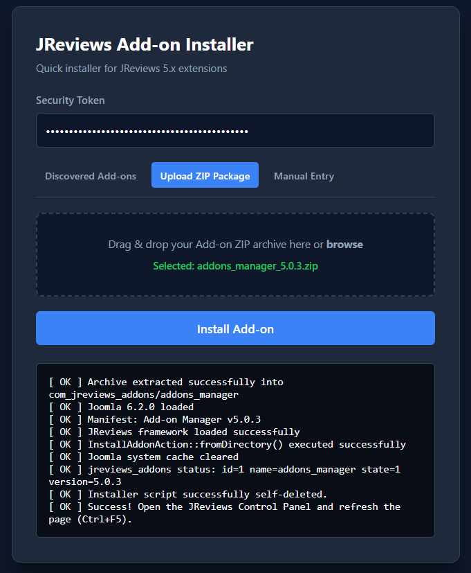

# JReviews-5.x-Add-on-One-Time-Web-CLI-Installer
As is well known, in JReviews 5.x there is no way to manually install the Add-on Manager without an active subscription and downloading it via the built-in marketplace. However, if you do not have a subscription but still happen to have a package containing your add-ons, there is a solution.

A lightweight, secure, and smart single-file utility script designed to effortlessly install **JReviews 5.x** add-ons into Joomla 4 and 5 environments without needing manual DB operations or navigating complex setups.

---

##  Features

-  **Modern Dark Web UI:** Clean and responsive interface built with vanilla HTML/CSS/JS (no external dependencies).
-  **Auto-Directory Scanning:** Automatically detects uninstalled add-on folders placed inside `components/com_jreviews_addons/`.
-  **ZIP Drag-and-Drop Upload:** Upload add-on `.zip` archives directly via the browser. The script auto-extracts and processes them.
-  **CLI Support:** Fully compatible with Command Line Interface (CLI) for server administration via SSH or automated scripts.
-  **Built-in Security:** Protected by a mandatory pre-shared token check (`JR_ONETIME_TOKEN`) and restricted header policies (`noindex`).
-  **Automatic Cleanup & Maintenance:** Runs JReviews core migrations, purges Joomla output cache, and automatically self-deletes upon successful execution.

---

##  Requirements

- **Joomla:** Version 4.x, 5.x, 6.x
- **JReviews:** Version 5.x (with active `s2framework`)
- **PHP:** Version 8.1+ (with `ext-zip` enabled for archive uploads)

---

##  Quick Start Guide

### 1. Installation
Upload `jr_install_addon.php` directly to your Joomla **root directory** (alongside `configuration.php` and the `/includes` folder).

### 2. Configuration
Open `jr_install_addon.php` in any text editor and update the secret token:

```php
const JR_ONETIME_TOKEN = 'your_long_random_secret_token_here'; // Must be at least 16 characters
const JR_SELF_DELETE = true; // Set to false if you want to keep the script after execution
```
### 3. Usage Options
Option A: Web UI (Browser)
Navigate to: https://your-site.com/jr_install_addon.php

Enter your JR_ONETIME_TOKEN.

Choose your preferred method:

Discovered Add-ons: Select an existing directory scanned from /components/com_jreviews_addons/.

Upload ZIP Package: Drag and drop your .zip archive.

Manual Entry: Enter the exact add-on folder name manually.

Click Install Add-on.

Option B: Direct URL Trigger
[https://your-site.com/jr_install_addon.php?token=YOUR_TOKEN&addon=addon_name](https://your-site.com/jr_install_addon.php?token=YOUR_TOKEN&addon=addon_name)
Option C: SSH / CLI Execution
Bash
php jr_install_addon.php token=YOUR_TOKEN addon=addon_name

🔒 Security Notes

⚠️ Important: This script bypasses Joomla's standard authentication checks by using its own token system to execute framework functions.

Always test on staging/test environments first.

Keep JR_SELF_DELETE set to true so the file removes itself immediately after installation.

If installation fails, make sure to manually delete jr_install_addon.php from your server root.

